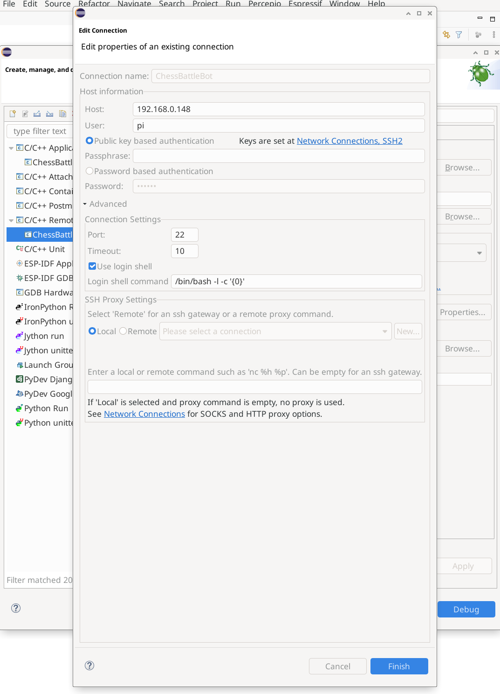
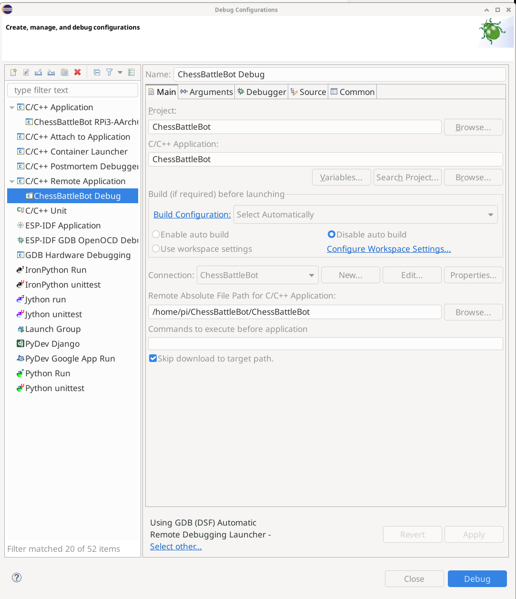
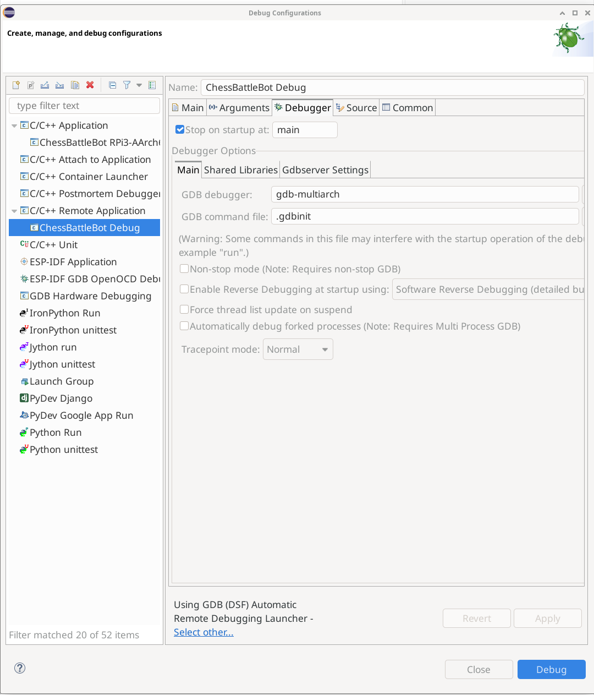
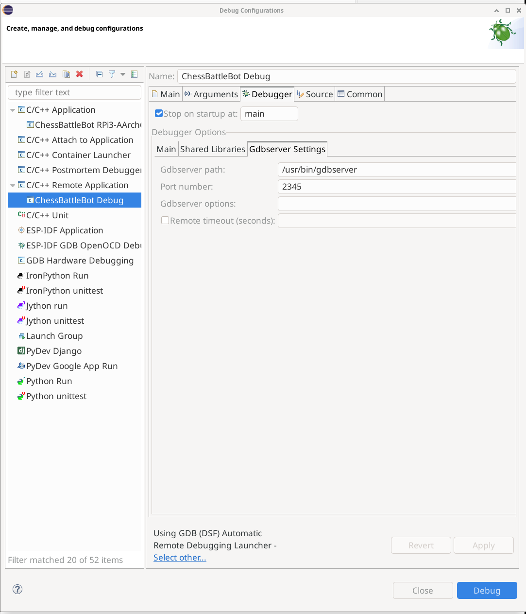
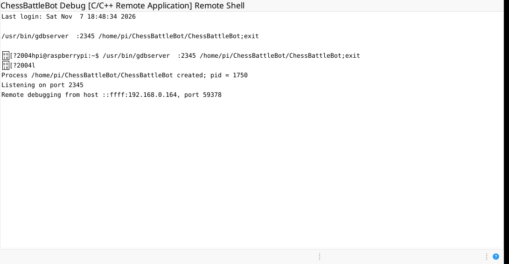

# Embedded Linux: Ultimate Guide to Remote C++ Debugging with Eclipse and GDB Server

This practical guide demonstrates how to set up your development environment for **remote C++ compilation and debugging** using **Eclipse IDE** on a Host computer (laptop/desktop) connected to an **Embedded Linux** target board (such as Raspberry Pi, Toradex, BeagleBone, etc.).

---

## 📑 Table of Contents

1. [Architecture Overview](#1-architecture-overview)
2. [Prerequisites on the Target Board](#2-prerequisites-on-the-target-board)
3. [Step-by-Step Configuration in Eclipse](#3-step-by-step-configuration-in-eclipse)
   * [Step 1: SSH Connection Setup](#step-1-ssh-connection-setup)
   * [Step 2: Main Application Paths](#step-2-main-application-paths)
   * [Step 3: Debugger & GDB Engine Options](#step-3-debugger--gdb-engine-options)
   * [Step 4: Gdbserver Settings](#step-4-gdbserver-settings)
4. [Execution Flow & Remote Shell Output](#4-execution-flow--remote-shell-output)
5. [How to Debug with Breakpoints](#5-how-to-debug-with-breakpoints)
6. [Troubleshooting Guide](#6-troubleshooting-guide)

---

## 1. Architecture Overview

In Embedded Linux projects featuring heavy binaries, hardware interfaces (I2C/SPI), or complex libraries (OpenCV, cameras, LVGL, libcurl, asynchronous threads), the recommended workflow consists of:

* **Host (Laptop/PC):** Code editing via Eclipse IDE.
* **Target (Remote Board):** Compilation (native/remote via SSH or cross-compilation) and binary execution monitored by `gdbserver`.
* **Connection:** Eclipse connects via SSH/TCP to the port opened by `gdbserver` to control breakpoints and inspect variables in real time.

---

## 2. Prerequisites on the Target Board

### A. Install `gdbserver`

On the Linux target board, ensure that the GDB server package is installed:

```bash
sudo apt update
sudo apt install gdbserver
```

### B. Compile with Debug Symbols

In your `Makefile` or build script on the target board, ensure the `-g` flag is included in `CXXFLAGS` so that debug symbol tables are embedded into the executable:

```makefile
CXXFLAGS = -std=c++17 -g -Wall ...
```

---

## 3. Step-by-Step Configuration in Eclipse

### Step 1: SSH Connection Setup

Navigate to **Window > Preferences > Remote Development > Connections** (or click **New...** beside **Connection** in the Debug Configuration dialog).



**Key Parameters:**
* **Host:** `<YOUR_TARGET_IP>` (e.g., `192.168.0.148`)
* **User:** `<REMOTE_USER>` (e.g., `pi`)
* **Authentication:** Select *Password* or *Public key based authentication*.
* **Advanced > Port:** `22` *(Must be standard SSH port 22. Avoid FTP ports such as 20 or 21)*.
* **Advanced > Timeout:** `10`
* **SSH Proxy Settings:** Set to **Local** with an empty proxy command string to avoid recursive SSH loopbacks.

---

### Step 2: Main Application Paths

Go to **Run > Debug Configurations...**, right-click **C/C++ Remote Application**, and select **New Configuration**.



**Key Parameters:**
* **Project:** Select your local Eclipse workspace project (`<PROJECT_NAME>`).
* **C/C++ Application:** Specify the local executable path or binary name (`<EXECUTABLE_NAME>`).
  > *Note: If building natively on the target board, create a dummy local file (`touch <EXECUTABLE_NAME> && chmod +x <EXECUTABLE_NAME>`) to satisfy Eclipse's validation.*
* **Build Configuration:** Select **Select Automatically** or **Use Active**, and ensure **Disable auto build** is checked under *Build (if required) before launching*.
* **Connection:** Choose your configured SSH connection (`<REMOTE_USER>@<YOUR_TARGET_IP>`).
* **Remote Absolute File Path for C/C++ Application:** Specify the exact binary location on the target board:
  `/home/<REMOTE_USER>/<PROJECT_FOLDER>/<EXECUTABLE_NAME>`
* **Skip download to target path:** **CHECK THIS BOX** to prevent Eclipse from overwriting the binary on the board.

---

### Step 3: Debugger & GDB Engine Options

Switch to the **Debugger** tab.



**Key Parameters:**
* **Stop on startup at:** `main` *(Pauses automatically at the entry point of your application)*.
* **GDB debugger:** `gdb-multiarch` (for cross-platform debugging) or `gdb`.
* **GDB command file:** `.gdbinit`

> **Note on Launchers:** At the bottom of the window, click **Select other...** and choose **Using GDB (DSF) Automatic Remote Debugging Launcher** or **C/C++ Remote GDB Launcher**.

---

### Step 4: Gdbserver Settings

Inside the **Debugger** tab, open the **Gdbserver Settings** sub-tab.



**Key Parameters:**
* **Gdbserver path:** `/usr/bin/gdbserver`
* **Port number:** `2345` *(Default communication port between Eclipse and the target)*.

---

## 4. Execution Flow & Remote Shell Output

When you click **Debug**, Eclipse automatically executes `gdbserver` on the remote target via SSH:



**Executed Command on Target:**
```bash
/usr/bin/gdbserver :2345 /home/<REMOTE_USER>/<PROJECT_FOLDER>/<EXECUTABLE_NAME>;exit
```

**Target Output:**
```text
Process /home/<REMOTE_USER>/<PROJECT_FOLDER>/<EXECUTABLE_NAME> created; pid = 1750
Listening on port 2345
Remote debugging from host ::ffff:<HOST_IP>, port 59378
```

---

## 5. How to Debug with Breakpoints

1. **Switch Perspective:** Open the **Debug Perspective** in Eclipse (**Window > Perspective > Open Perspective > Debug**).
2. **Set Breakpoints:** Double-click the left ruler margin next to any code line in your editor to add a blue breakpoint marker.
3. **Control Shortcuts:**
   * **`F8` (Resume / ▶):** Continue execution until the next breakpoint.
   * **`F6` (Step Over / ↷):** Execute current line without entering functions.
   * **`F5` (Step Into / ↴):** Step into the function call.
   * **`F7` (Step Return / ⬆):** Step out of current function.
   * **`Ctrl + F2` (Terminate / ⏹):** End session and stop remote process.

---

## 6. Troubleshooting Guide

### ❌ Error: "Program does not exist"
* **Cause:** Eclipse checks for a local executable file on the Host before initiating the launch.
* **Fix:** Create a dummy file locally in your project root:
  ```bash
  touch <EXECUTABLE_NAME> && chmod +x <EXECUTABLE_NAME>
  ```

### ❌ Error: "Error during file upload"
* **Cause:** Eclipse attempts to upload the binary via SFTP before debugging.
* **Fix:** Check **Skip download to target path** on the **Main** tab of Debug Configurations.

### ❌ Error: "java.lang.StackOverflowError"
* **Cause:** Circular SSH proxy loops or incorrect SSH port settings in Eclipse.
* **Fix:** 
  1. Set SSH connection port to **22** (do not use FTP port 20).
  2. Set **SSH Proxy Settings** to **Local** with an empty command field.
  3. Change launcher via **Select other...** to **GDB (DSF) Automatic Remote Debugging Launcher**.

### ❌ Debugger freezes on internal OS signals
* **Cause:** GDB intercepts inter-thread signals (`SIGPIPE`, `SIGUSR1`, etc.).
* **Fix:** Go to **Window > Preferences > C/C++ > Debug > GDB > Signals** and uncheck *Suspend* for non-critical application signals.

---
*Generic guide for Embedded Linux C++ Remote Debugging with Eclipse IDE.*